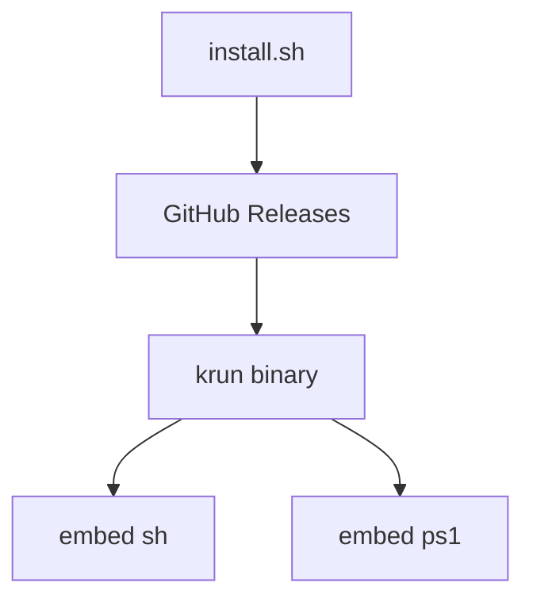

# Krun 需求文档

## 背景与目标

运维脚本工具集：`lib/sh`（bash）+ `lib/ps1`（PowerShell），由 Go CLI（`cmd/krun`）**`go:embed` 打进单一二进制**后执行。

`install.sh` 只从 GitHub Release 安装 CLI；**运行脚本不再访问网络**。

**非目标**

- 不再提供 `lib/py` / Python CLI
- 不再维护 `meta/lib-manifest.json`（列表来自 embed 扫描）
- 不在 CI 做真实 Windows 装机验收

## 用户与权限

- Linux/mac 脚本多数需 root/sudo
- Windows 装机 / 防火墙 / 远程需 Administrator
- Windows 强制重装：`-Force` 或 `$env:FORCE_INSTALL='true'`

## 功能需求

### FR-KRUN-01 脚本与嵌入

| 路径 | 说明 |
| --- | --- |
| `lib/sh/*.sh` | Linux/mac 权威脚本 |
| `lib/ps1/*.ps1` | Windows 权威脚本 |
| `lib/fs.go` | `//go:embed all:sh all:ps1` |
| `cmd/krun` | 列表 / 解析 / 调 bash 或 pwsh |

**验收**：无网环境下 `krun list` 与 `krun hello_world` 成功；source 为 `embed:…`。

### FR-KRUN-02 发布与安装

- GoReleaser：linux/darwin/windows × amd64/arm64 + deb/rpm + checksums
- 产物：`krun_<ver>_<os>_<arch>.tar.gz`（Windows zip）
- `install.sh`：按 OS/Arch 安装；`KRUN_VERSION` 可钉版本
- **`rake push` / `ruby push.rb`**：有新 commit 时自动 **patch +1** 打 `vX.Y.Z` annotated tag 并 `git push` tag（触发 Release）。`KRUN_BUMP=minor|major` 可改；`SKIP_TAG=1` 跳过

**验收**：`v*` tag 发布后 `curl …/install.sh | bash` 得到可用 `krun`；本地 `rake push` 后出现新 tag。

### FR-KRUN-WIN 远程与装机

见 `lib/ps1/`：`config_remote.ps1`（开 RDP 后 `Restart-Service TermService`；防火墙开才加规则）、`disable_firewall.ps1`、各 `install_*.ps1`。`krun install_windows_all.ps1` 由 CLI 依次跑嵌入的 `install_*.ps1`。

## 架构概览

## 测试验收

1. `go test ./...` && `rake build`
2. `krun list` → ~95；`krun hello_world`
3. 拷贝二进制到无仓库目录仍可跑
4. `test ! -d lib/py` && `test ! -d meta`

## 变更记录

| 日期 | 说明 |
| --- | --- |
| 2026-11-11 | 删除 meta/manifest、旧 nfpm、deploy.sh、lib/py；CLI 仅 embed |
| 2026-11-11 | go:embed；Go CLI + GoReleaser；config_remote TermService |

## 开发进度记录

### 2026-11-11（auto tag on push）

- **做了什么**：`rake push` 在新 commit 后自动 patch 递增打 annotated `v*` tag 并推送
- **验证**：本地计算 next tag 逻辑；未对本机执行真实 push

### 2026-11-11（cleanup more）

- **做了什么**：删除 `templates/`、`scripts/`、`.editorconfig`、`.rubocop.yml`、`lib/*/README.md`；goreleaser 去掉 postinstall 脚本
- **验证**：`go test ./...`；`rake build`；`krun status`

### 2026-11-11（cleanup）

- **验证**：`go test ./...`；`krun list`；无 `meta/` / `lib/py`
